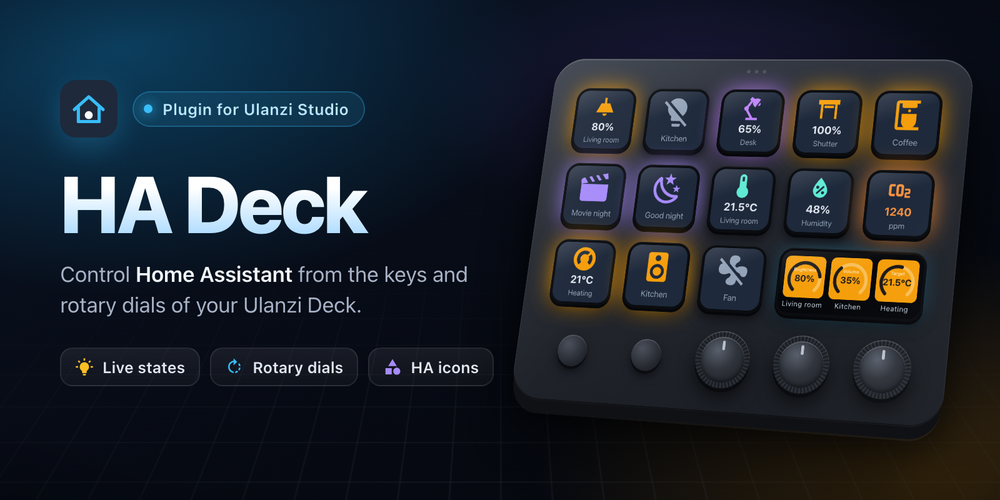

# HA Deck – Home Assistant for Ulanzi Deck



Control [Home Assistant](https://www.home-assistant.io/) from the keys **and the rotary dials** of
an Ulanzi Deck. Built on the official
[UlanziDeckPlugin-SDK](https://github.com/UlanziTechnology/UlanziDeckPlugin-SDK).

## Features

| Action | Hardware | What it does |
|---|---|---|
| **HA Toggle** | key | Toggles a light, switch, fan, cover, media player, thermostat or `input_boolean` and shows its live state (brightness in % for dimmable lights). A long press starts edit mode for the Dynamic Dial or runs a configurable alternative. |
| **HA Dial** | dial | Bound to one value of one entity: brightness, colour temperature, volume, target temperature, cover position, fan speed or an `input_number`/`number`. Turn = fine steps, turn while pressed = coarse steps. **Press**: configurable – toggle / play-pause (default), switch the controlled value (e.g. brightness ↔ colour temperature), set a favourite value, mute, next track, cycle thermostat mode or preset, stop a moving cover, fan oscillation or preset, call any service, or nothing. |
| **HA Dynamic Dial** | dial | Follows the entity of a long-pressed HA Toggle key: brightness, volume, temperature, position or fan speed – one dial for any number of entities. **Press**: end editing (default), toggle the edited entity, switch the controlled value, or nothing. |
| **HA Trigger** | key | Activates a scene or script, or triggers an automation. |
| **HA Sensor** | key | Shows a sensor value with unit; turns orange outside optional limits. |
| **HA Service Call** | key | Calls any service with target entities and JSON data. |

**Home Assistant icons on keys.** HA Toggle, HA Trigger and HA Sensor keys show the same
[Material Design icon](https://pictogrammers.com/library/mdi/) that Home Assistant shows for the
entity in its current state: a custom icon set in Home Assistant, otherwise the default icon for
the domain, device class and state (e.g. bulb / bulb off, open / closed shutter, battery level).
Lights that are on show the icon in their actual colour. In each key's settings you can pick a
different icon by name (`mdi:coffee-maker`, with preview), set your own colours (on/off for HA
Toggle), or switch the icon off to get the text layout. HA Service Call keys show an icon only if
you enter one.

The display reacts immediately to every dial detent; Home Assistant receives at most five calls
per second per entity, and the final value always arrives. The plugin reconnects automatically
after Home Assistant restarts. The UI is available in English and German.

### Supported Ulanzi decks

The plugin runs in Ulanzi Studio and supports every device type the Ulanzi plugin SDK knows
(`D200`, `D200H`, `D200X`, `Dial`). Which actions you can use depends on the hardware:

| Device | Key actions (Toggle, Trigger, Sensor, Service Call) | Dial actions (HA Dial, HA Dynamic Dial) | Tested |
|---|---|---|---|
| **Ulanzi D200X** (keys + 3 dials) | ✅ | ✅ | ✅ |
| Ulanzi D200 | ✅ | – (no dials) | not yet |
| Ulanzi D200H | ✅ | if the model has dials | not yet |
| Ulanzi Dial (SDK device type `Dial`) | if the device has keys | ✅ | not yet |

Dial actions can only be placed on dials, so they do not appear on key-only decks. Long-press
editing with the Dynamic Dial needs a deck with at least one dial. Reports from other models are
welcome as [issues](https://github.com/dark-m0de/ulanzi-studio-HA-plugin/issues).

### Requirements

- Ulanzi Studio 3.3.0 or newer on macOS or Windows
- Home Assistant 2024.1 or newer (Home Assistant's own icons need 2024.2 or newer; older versions
  use built-in icons, and the settings page shows a hint)

## Installation

1. Download **`com.ulanzi.hadeck.ulanziPlugin.zip`** from the
   [latest release](https://github.com/dark-m0de/ulanzi-studio-HA-plugin/releases/latest)
   (direct link: [com.ulanzi.hadeck.ulanziPlugin.zip](https://github.com/dark-m0de/ulanzi-studio-HA-plugin/releases/latest/download/com.ulanzi.hadeck.ulanziPlugin.zip)).
   All versions are listed on the [releases page](https://github.com/dark-m0de/ulanzi-studio-HA-plugin/releases).
2. Quit Ulanzi Studio and unzip the file into the plugins directory, so that the folder
   `com.ulanzi.hadeck.ulanziPlugin` ends up directly inside it:
   - macOS: `~/Library/Application Support/Ulanzi/UlanziDeck/Plugins`
   - Windows: `%APPDATA%\Ulanzi\UlanziDeck\Plugins`
3. Start Ulanzi Studio. The actions appear in the category **Home Assistant**.

To update, quit Ulanzi Studio, replace the folder with the one from the new zip and start Ulanzi
Studio again. Your key and dial settings and the connection are kept.

### Connect to Home Assistant

1. In Home Assistant, open your **profile → Security → Long-lived access tokens** and create a token.
2. Drag any HA action onto a key, enter the Home Assistant URL (for example
   `http://homeassistant.local:8123`) and the token, then press **Test & save**.
3. The connection is stored once for all actions. No CORS settings are needed in Home Assistant.

The token is stored locally in Ulanzi Studio only, is never shown again in the settings page and is
removed from every log line.

### Use only one Dynamic Dial

Assign **HA Dynamic Dial** to one dial per device. Then hold any HA Toggle key (default 500 ms):
the key shows **EDIT** and the Dynamic Dial controls that entity until you press the key or the
Dynamic Dial, after 10 s without input, or when you switch pages. Pressing the Dynamic Dial means
"done" by default; in its settings you can instead let a press toggle the entity or switch between
brightness and colour temperature. If you assign the Dynamic Dial to several dials, they all control
the same value.

When an entity has more than one controllable value (e.g. a lamp with colour temperature), the dial
and the edited key show a short name of the value that is currently controlled.

## Development

Requires Node.js ≥ 20.12.

```bash
npm install
npm test            # unit + integration tests with coverage, no device needed
npm run build       # bundles src/ into plugin/com.ulanzi.hadeck.ulanziPlugin/dist/app.js
npm run dev:link    # symlinks the plugin folder into the Ulanzi Studio plugins directory
npm run package     # builds com.ulanzi.hadeck.ulanziPlugin.zip (includes LICENSE and NOTICE)
```

- Set `HADECK_PLUGIN_DIR` to override the plugins directory used by `dev:link`.
- Debugging: start Ulanzi Studio with `--log --nodeRemoteDebug`; the main service listens on
  `127.0.0.1:9231`. Set `HADECK_DEBUG=1` for debug logging.
- The code is split into three layers: `src/ha` (Home Assistant client), `src/domain` (pure logic)
  and `src/adapter` (Ulanzi SDK binding). The first two never import the SDK.
- Specification, plan and tasks live in [`specs/001-ha-deck-plugin`](specs/001-ha-deck-plugin)
  ([spec-kit](https://github.com/github/spec-kit)); project principles in
  [`.specify/memory/constitution.md`](.specify/memory/constitution.md).
- Listing images: `node marketing/generate.mjs` renders the Ulanzi Workshop cover and banners
  (`marketing/out/`) and the README image (`docs/readme-banner.png`) with the plugin's own key and
  dial renderers. It needs a Chromium (Playwright's headless shell or Chrome; override with
  `CHROME_PATH`). Listing texts are in [`marketing/listing-texts.md`](marketing/listing-texts.md).

### Continuous integration and releases

- **Tests on every pull request**: `.github/workflows/test.yml` runs `npm test` and `npm run build`
  on Linux, macOS and Windows. The job **All tests passed** is green only if all of them succeed.
- **Merge protection**: `.github/rulesets/main.json` protects the default branch: changes need a
  pull request and the check **All tests passed** must be green (and up to date) before merging.
  Apply it once (needs admin rights on the repository):

  ```bash
  gh api repos/dark-m0de/ulanzi-studio-HA-plugin/rulesets --method POST --input .github/rulesets/main.json
  ```

  or in the browser under *Settings → Rules → Rulesets → New ruleset → Import a ruleset*.
- **Releases**: `.github/workflows/release.yml` runs when a version tag is pushed. It runs the full
  test matrix, checks that the tag matches the versions in `package.json` and `manifest.json`,
  builds the zip and uploads it to the GitHub release. Tags with a suffix (e.g. `v0.2.0-beta.1`)
  become pre-releases.

  To publish version 0.2.0: set `"version": "0.2.0"` in `package.json` and `"Version": "0.2.0"` in
  `plugin/com.ulanzi.hadeck.ulanziPlugin/manifest.json`, merge, then tag the merged commit:

  ```bash
  git tag v0.2.0 && git push origin v0.2.0
  ```

## License

Apache License 2.0 – see [LICENSE](LICENSE) and [NOTICE](NOTICE).

Icons: [Material Design Icons](https://pictogrammers.com/library/mdi/) by Pictogrammers
(`@mdi/js`, Apache License 2.0), bundled with the plugin.

This project is not affiliated with, endorsed by, or sponsored by Ulanzi or the Home Assistant
project / Open Home Foundation. "Home Assistant" and "Ulanzi" are trademarks of their respective
owners.
